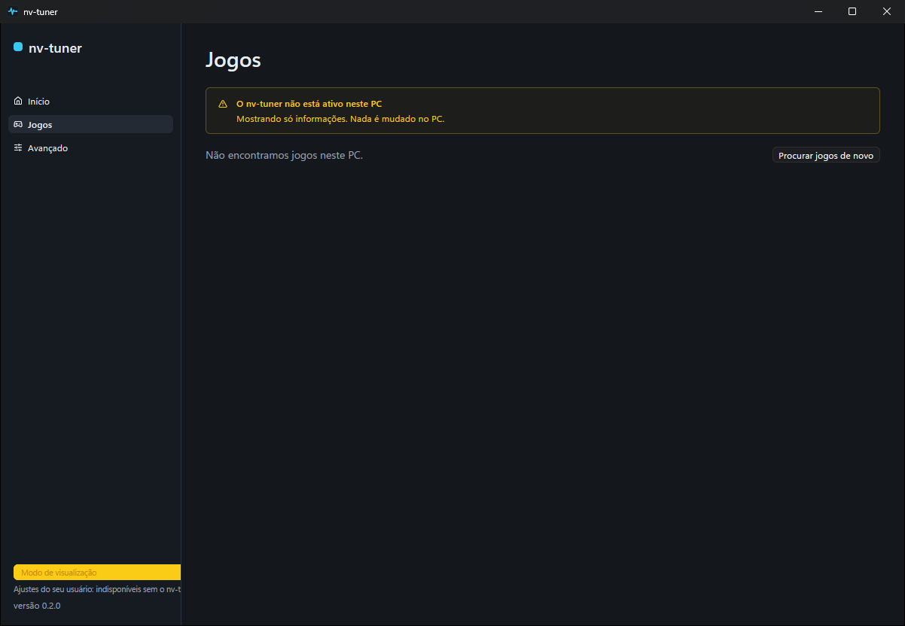

# Changelog

Todas as mudanças relevantes do nv-tuner ficam registradas aqui.

O formato segue o [Keep a Changelog](https://keepachangelog.com/pt-BR/1.1.0/)
e o projeto adota o [Versionamento Semântico](https://semver.org/lang/pt-BR/).
As notas de cada release no GitHub são montadas a partir da seção da versão
(veja “Como lançar uma versão” no [CONTRIBUTING.md](CONTRIBUTING.md)).

## [Não lançado]

## [0.0.2] - 2026-11-25

*O que o app fez em cada jogo*

### Adicionado

- **"O que o app fez" em cada jogo.** A tela **Jogos** agora explica, linha a linha, o que foi aplicado e por quê. Exemplos:
  - `Preset E do DLSS (Turing)`: nas RTX 20, o modelo antigo do DLSS custa menos GPU (+17% de FPS medido no WARDOGS).
  - `Nenhum ajuste específico: GPU Ada roda o DLSS padrão sem custo extra`: nas RTX 40/50 o app não força nada.
  - `Nenhum ajuste específico: jogo sem DLSS`.
  - `herda 14 ajustes globais`, com clique na linha para ver cada regra aplicada ou não aplicada e o motivo.

### Alterado

- A tela Jogos passa a usar os dados do **serviço** quando ele está conectado.
- Protocolo entre interface e serviço atualizado para a **v3**. A interface avisa se as versões não baterem.
- GitHub Actions atualizadas (sem Node 20).

  

## [0.0.1] - 2026-11-25

*Primeira versão pública (pré-alfa)*

### Adicionado

- **Detecção automática** da GPU por arquitetura (Turing, Ampere, Ada, Blackwell) e dos jogos instalados (Steam, Riot, Epic, GOG, Ubisoft, EA, Battle.net, Xbox), incluindo API gráfica, DLSS, Reflex e anticheat.
- **Regras declarativas** (TOML) sobre capacidades da GPU: base global estável (baixa latência, energia, shader cache, limpeza de filtragem forçada) e preset E do DLSS nas RTX 20.
- **Serviço do Windows** que aplica sozinho, vigia o banco de perfis do driver, reaplica após atualização de driver e respeita mudanças manuais.
- **Interface em GPUI** com 6 telas em português e restauração do estado original.
- Instalador MSI.

[Não lançado]: https://github.com/luansilvadb/nv-tuner/compare/v0.0.2...HEAD
[0.0.2]: https://github.com/luansilvadb/nv-tuner/compare/v0.0.1...v0.0.2
[0.0.1]: https://github.com/luansilvadb/nv-tuner/releases/tag/v0.0.1
