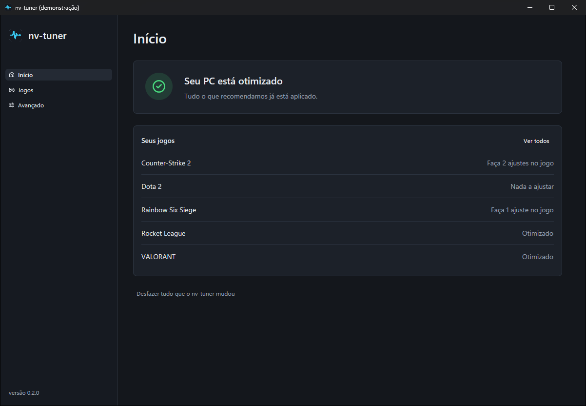
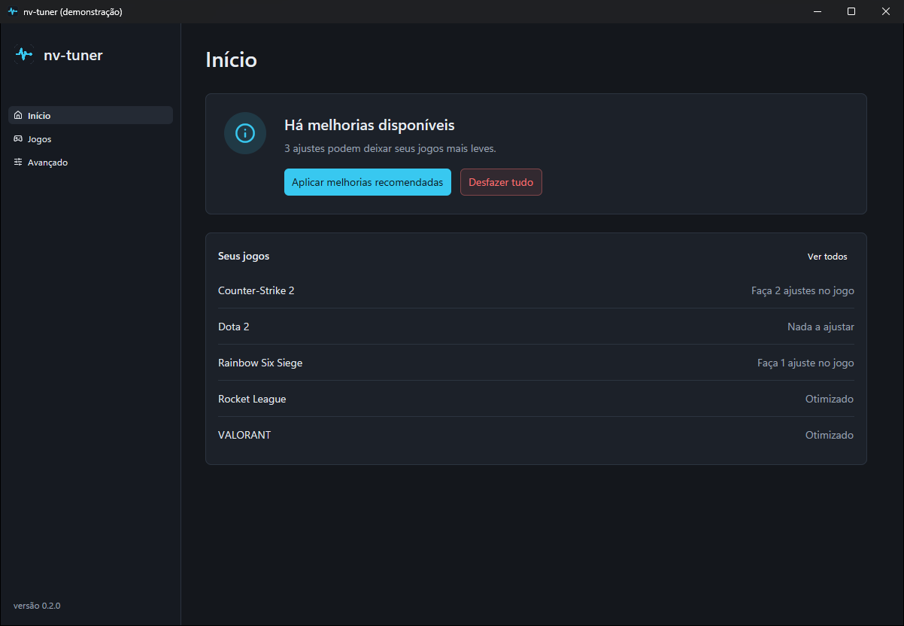
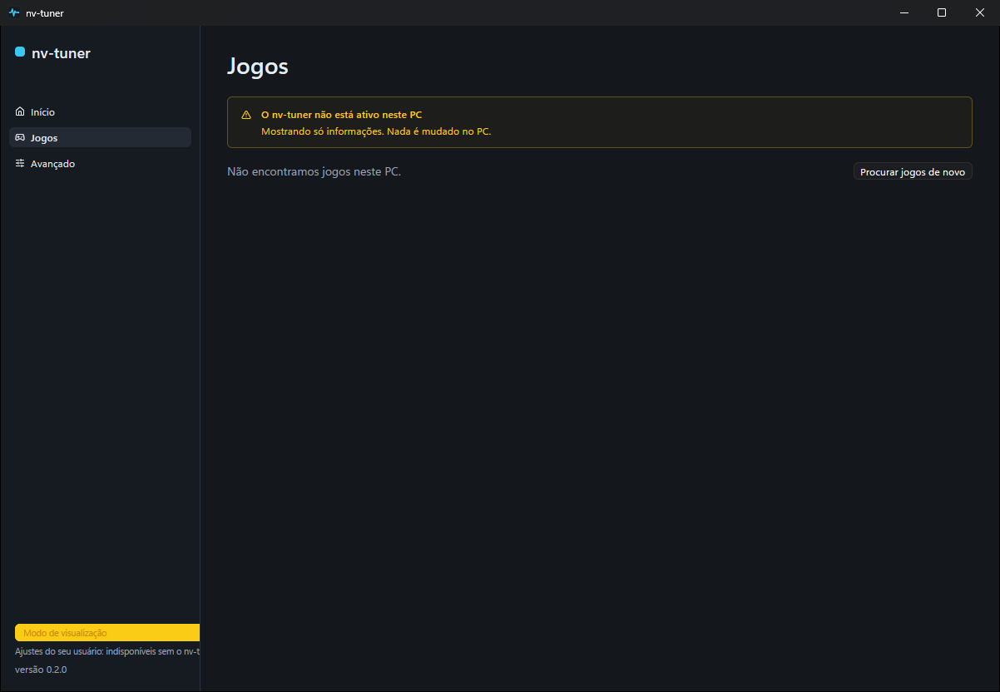
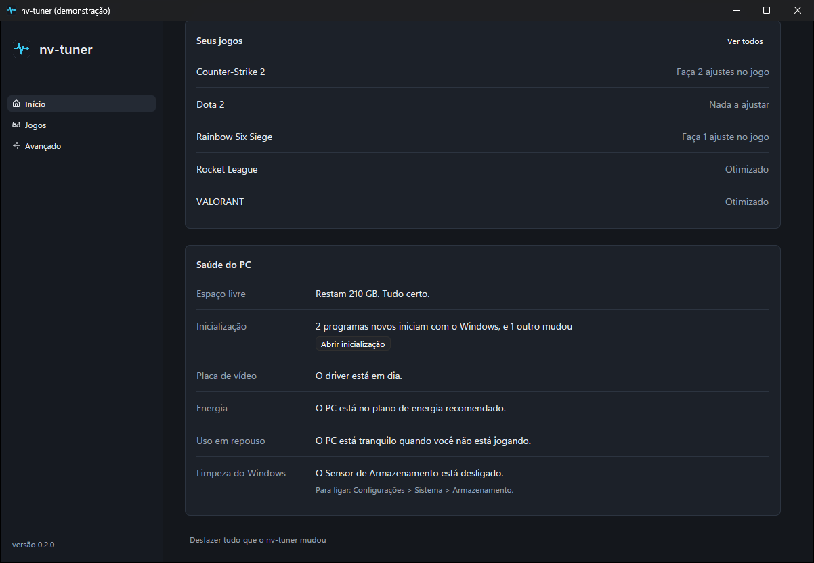

<p align="center"></p>

# nv-tuner

Ajuste automático do perfil do driver NVIDIA no Windows — global e por jogo —
a partir de regras declarativas sobre as capacidades da sua GPU, os fatos de
cada jogo instalado e as suas preferências.

> **Aviso:** o nv-tuner altera configurações do perfil do driver NVIDIA
> (DRS) do seu sistema. Antes da primeira mudança ele guarda um snapshot dos
> valores originais, e tudo o que alterou pode ser desfeito em
> **Restaurar original** (veja [Instalação](#instalação)).

## Status

**Pré-alfa (v0.2.0).** Serviço, interface, motor de regras e instalador já
funcionam, mas o projeto foi testado em pouquíssimas máquinas (uma GPU Turing,
um driver). Espere bugs, mudanças de formato entre versões e regras ainda
`experimental`. Use por sua conta e risco, de preferência sabendo restaurar o
perfil do driver.

- O MSI **não é assinado** digitalmente (veja o aviso do SmartScreen abaixo).
- Os lançamentos são publicados como release normal (Latest), assinados com
  Minisign.
- A partir da v0.1.0 (primeira versão com atualizador, instalada à mão uma
  vez), o nv-tuner **se atualiza sozinho** (veja [Atualização automática](#atualização-automática)).

## Interface

A interface foi refeita para quem não entende de placa de vídeo: três itens na
lateral (**Início**, **Jogos** e **Avançado**), tema escuro, linguagem simples e
nenhuma sigla técnica nas telas principais.

- **Boas-vindas:** na primeira abertura, uma tela curta explica o que o app faz
  e tem um único botão, **Começar**. Ela não volta a aparecer.
- **Início:** mostra um único veredito sobre o PC (por exemplo, “Seu PC está
  otimizado”, “Há melhorias disponíveis”, “Há mudanças esperando o jogo
  fechar” ou “Os ajustes estão desligados”) e, no topo, no máximo uma linha de
  estado (serviço ausente, jogo aberto, atualização, agente ausente).
- **Aplicar melhorias recomendadas:** aparece quando há regras experimentais
  aplicáveis neste PC. Um clique aceita todas de uma vez (driver, Windows e
  arquivos de jogo) e aplica; com jogo aberto, a aplicação espera o jogo
  fechar. É reversível, sem diálogo de confirmação.
- **Desfazer tudo:** pede confirmação e volta tudo ao original (o mesmo
  **Restaurar original** de antes). Os ajustes ficam desligados até você
  clicar em **Voltar a ajustar**.
- **Jogos:** cada jogo com um status simples (“Otimizado”, “Faça 2 ajustes no
  jogo”, “Aguardando o jogo fechar”) e o detalhe ao clicar.
- **Avançado:** tudo o que a v0.2.0 já fazia, com os termos técnicos: visão
  técnica, mudanças por perfil com Aceitar/Retirar, Windows, arquivo do jogo,
  preferências, histórico, Restaurar original, reescanear jogos e verificar
  atualização, além dos grupos novos **Inicialização** e **Manutenção**.
- **Modo de demonstração:** `nvt-ui --demonstracao <cenário>` abre a interface
  com dados fictícios fixos, sem serviço e sem ler a máquina (cenários
  `otimizado`, `melhorias`, `piorou`, `jogo-aberto`, `desligado`, `atualizado`,
  `sem-servico`, `primeira-vez` e `saude`). É o que gera as capturas abaixo.

<p align="center">
  
</p>

<p align="center">
  
</p>

<p align="center">
  
</p>

Outras capturas (boas-vindas, jogo aberto, ajustes desligados, Avançado) ficam
em [`docs/ui-capturas/`](docs/ui-capturas/).

## Saúde do PC

O Início ganhou a seção **Saúde do PC**, que **só mostra** o estado do
computador, em frases simples, com o caminho do Windows quando houver algo a
fazer à mão:

- espaço livre no disco do sistema;
- memória e processador em repouso (sem jogo aberto);
- driver NVIDIA mais antigo que a última versão conhecida pelo app (lista
  embutida, sem consulta à internet);
- plano de energia diferente do esperado;
- Sensor de Armazenamento do Windows desligado;
- programas que iniciam com o Windows, com destaque para os **novos ou
  alterados** desde a última vez.

Tudo isso é **somente leitura**. Os programas de inicialização são **apenas
detectados, nunca desativados, editados ou removidos**: o botão **Abrir
inicialização** abre a página do próprio Windows (Configurações > Aplicativos >
Inicialização), e fica bloqueado com jogo aberto. O app não grava caminhos
completos nem linhas de comando desses programas.

<p align="center">
  
</p>

**Limpeza de temporários:** já existe no código, mas está **desligada nesta
versão**. Quando for ligada, depois de validada em laboratório, ela vai apagar
só arquivos antigos (7 dias ou mais) das pastas temporárias do usuário e do
Windows, nunca com jogo aberto ou instalação em andamento, no máximo uma vez
por dia. O objetivo é **só liberar espaço em disco**: ela não deixa os jogos
mais rápidos e o app não promete ganho de FPS por ela.

**Gravação de partidas:** a medição do desempenho de cada partida existe
**só num build de teste do mantenedor**, compilado à parte. Ela **não está nas
releases** nem no MSI publicado, e não há opção para ligá-la.

## Atualização automática

O serviço do nv-tuner mantém o app na última versão estável publicada aqui no
GitHub, **sem você fazer nada** e sem opção de desligar:

- **Verifica a cada ~6 h** (a primeira vez entre 5 e 15 min depois de o serviço
  iniciar), baixando só um manifesto pequeno de `github.com`. O pedido não leva
  dados pessoais, identificador nem cookies; não há telemetria.
- **Só instala versão assinada e maior que a instalada.** O manifesto e o MSI
  são conferidos com a chave Minisign do projeto (embutida no app) e pelo SHA-256
  antes de instalar; versão igual ou menor, ou assinatura inválida, é recusada.
- **Nunca com jogo aberto:** usa o mesmo portão das gravações no driver; com jogo
  ou anticheat aberto (ou lista de processos ilegível), espera e reavalia a cada
  minuto.
- **Silenciosa:** instala com `msiexec /qn /norestart`. **Nunca reinicia o
  Windows**; se o instalador pedir reinício, a interface só avisa.
- **Preserva seus ajustes:** a atualização não restaura nem apaga o perfil do
  driver, os ajustes do Windows, os aceites nem o histórico.
- O agente é reaberto sozinho nas sessões em que estava aberto; a interface, se
  estava aberta, pede para ser fechada e aberta de novo. Depois, o **Início**
  mostra “Atualizado para a vX.Y.Z” uma vez e, sempre, a versão, a última
  verificação e qualquer pendência.
- **Sem internet**, nada é bloqueado: o app continua funcionando normalmente, a
  linha de estado do Início mostra “sem conexão com o GitHub” e a próxima tentativa é feita com
  espera crescente (30 min, 1 h, 2 h… até 6 h).
- Uma versão que falhar ao instalar 3 vezes é deixada de lado até sair outra maior.

**Bootstrap:** versões anteriores ao atualizador (como a v0.0.2) não sabem se
atualizar. Instale **uma vez, à mão**, a primeira versão com atualizador
(baixe o MSI e instale por cima, como em [Instalação](#instalação)); dali em
diante as atualizações são automáticas.

Para conferir uma release à mão com o `minisign` oficial, veja “Verificação
manual” no [CONTRIBUTING.md](CONTRIBUTING.md#verificação-manual-usuários) (a
chave pública está em [`instalador/nv-tuner-minisign.pub`](instalador/nv-tuner-minisign.pub)).

## Instalação

Requisitos: Windows 10 ou 11 de 64 bits, GPU NVIDIA com o driver instalado e
conta de administrador (o instalador pede elevação pelo UAC).

1. Baixe `nv-tuner-<versão>-x64.msi` e `nv-tuner-<versão>-x64.msi.sha256` na
   página de [Releases](../../releases).
2. Confira o SHA256 no PowerShell, na pasta do download:

   ```powershell
   (Get-FileHash .\nv-tuner-<versão>-x64.msi -Algorithm SHA256).Hash.ToLower()
   Get-Content .\nv-tuner-<versão>-x64.msi.sha256
   ```

   Os dois valores precisam ser idênticos; se não forem, não instale.
3. Execute o MSI. Como ele não é assinado, o Windows SmartScreen pode mostrar
   “O Windows protegeu o computador”: clique em **Mais informações** →
   **Executar assim mesmo** (só depois de conferir o SHA256).
4. O instalador registra o serviço `nv-tuner (serviço)`, cria o atalho
   **nv-tuner** no Menu Iniciar e registra o agente `nvt-agente` para iniciar
   no logon de cada usuário. A interface e o agente rodam sem privilégios.

### Desinstalar

Em **Configurações → Aplicativos → Aplicativos instalados → nv-tuner →
Desinstalar**, ou `msiexec /x nv-tuner-<versão>-x64.msi`.

A desinstalação **não** desfaz as mudanças no perfil do driver nem os
ajustes do Windows por padrão. Para voltar aos valores originais:

- antes de desinstalar, use **Restaurar original** na interface; ou
- desinstale pela linha de comando (como administrador), com o mesmo MSI:

  ```powershell
  msiexec /x nv-tuner-<versão>-x64.msi RESTAURAR_PERFIL=1 /l*v desinstalacao.log
  ```

  Se a restauração falhar, a desinstalação continua mesmo assim, e o motivo
  fica registrado no log. Feche os jogos antes: com um jogo aberto, nada é
  restaurado — o comando de restauração sai com código 3 e o log diz que a
  restauração **não** foi feita; nesse caso, feche os jogos e rode a
  desinstalação de novo (ou use **Restaurar original** antes de desinstalar).
  Os dados do app (snapshot e histórico) ficam em
  `%ProgramData%\nv-tuner`: reinstalando o nv-tuner, **Restaurar original**
  volta a funcionar.

Com `RESTAURAR_PERFIL=1`, a desinstalação restaura o driver e os ajustes do
Windows **apenas do usuário que está desinstalando** (o agente roda
`nvt-agente --restaurar` com a conta dele; executada como SYSTEM ou sem
usuário interativo, essa parte é pulada). **Outros usuários da máquina
precisam usar Restaurar original antes da desinstalação**: os snapshots
deles ficam em `%LOCALAPPDATA%\nv-tuner\usuario` de cada perfil e não são
apagados. A desinstalação pede ao Restart Manager que feche o agente de forma
cooperativa, sem forçar; agentes de outras sessões não são fechados por ele
(feche-os com logoff dessas contas). A restauração bloqueada (jogo aberto)
fica registrada no log, sem impedir a remoção. Numa atualização por cima,
nada é restaurado.

## Como reportar problemas

Abra uma [issue](../../issues) com:

- versão do nv-tuner, modelo da GPU, versão do driver e do Windows;
- o que você fez, o que esperava e o que aconteceu;
- a linha de estado do **Início** e os avisos do **Avançado** e, se for o caso, o log do instalador
  (`/l*v`).

Revise o que for anexar: **não inclua dados pessoais** (nome de usuário,
caminhos da sua máquina, números de série). Vulnerabilidades de segurança
**não** vão em issue pública: veja [SECURITY.md](SECURITY.md).

## O que é

- Lê as capacidades da GPU e detecta os jogos instalados (bibliotecas como
  Steam/Epic/GOG + catálogo de perfis do driver).
- Avalia regras em TOML (pasta [`regras/`](regras/)) e gera um **plano de
  configuração** auditável.
- Um serviço do Windows aplica o plano via NVAPI DRS; a interface roda sem
  privilégios de administrador.
- Prioridade das decisões: **estabilidade > latência > FPS**, respeitando um
  teto de qualidade (padrão: "Equilibrado") e as escolhas manuais do usuário.
- Ajusta, por mecanismos oficiais, três camadas: o **driver NVIDIA** (perfis
  DRS via NVAPI), o **Windows** (configurações documentadas, por APIs do
  sistema, só itens de uma lista permitida — veja [Ajustes do
  Windows](#ajustes-do-windows-experimental)) e os **arquivos de configuração
  do usuário de alguns jogos (nunca a pasta de instalação)**, incluindo as
  opções de inicialização da Steam, sempre com valores que o próprio jogo
  oferece no menu (veja [Configuração de
  jogos](#configuração-de-jogos-experimental)).
- Toda alteração é registrada, explicada e pode ser desfeita com **Restaurar
  original**.
- Nunca injeta código, nunca abre processos de jogos ou de anticheats (vê os
  jogos abertos só pela lista de processos, por nome), nunca altera
  executáveis nem arquivos da pasta de instalação dos jogos (só os lê, com
  compartilhamento total), nunca mexe em recursos de segurança (Secure Boot,
  TPM, VBS/HVCI) nem no BCD e adia qualquer gravação (no driver, no Windows e nos arquivos de jogo) enquanto detecta
  um jogo (instalado detectado ou da base competitiva) ou anticheat aberto.
  Como a detecção é por nome, ela pode falhar; por isso a promessa é “adia
  enquanto detecta”. Enquanto isso, a faixa **Jogo aberto** da interface
  mostra o que ficou pendente; o serviço confere a cada 15 s e executa a ação
  quando o jogo fecha; se a ação falhar, ela é tentada de novo (até 3 vezes)
  antes de virar aviso. Se o serviço não conseguir ler a lista de processos,
  também adia, e a interface diz que não foi possível verificar se há jogo
  aberto. Uma aplicação pendente fica só na memória do serviço (se ele
  reiniciar, o próximo ciclo refaz a aplicação); uma **restauração pendente
  é gravada** e sobrevive ao reinício do serviço.

## Foco competitivo

- **Base curada de 14 jogos competitivos** ([`regras/jogos.toml`](regras/jogos.toml)):
  Counter-Strike 2, VALORANT, League of Legends, Fortnite, Apex Legends,
  Overwatch 2, Rainbow Six Siege, Call of Duty, Rocket League, PUBG:
  Battlegrounds, Dota 2, Marvel Rivals, Deadlock e THE FINALS. Para cada um, o
  plano traz orientações **“Faça no jogo”** (por exemplo, Reflex em
  *On + Boost*, limitador de FPS do próprio jogo, tela cheia), que o app não
  aplica: quem muda é você, no menu do jogo. Na tela **Jogos**, esses jogos
  ganham o selo **competitivo** (e **aberto**, se estavam em execução na
  última varredura), e as orientações aparecem na seção **Faça no jogo** ao
  expandir a linha.
- **Taxa de atualização e VRR (G-SYNC)** do monitor principal lidos pela
  NVAPI e mostrados no **Avançado**, com aviso quando o modo G-SYNC é escolhido sem VRR ativo.
- **Limite de FPS para G-SYNC** um pouco abaixo da taxa do monitor (por
  exemplo, 224 FPS a 240 Hz). Por ora a regra é *experimental*: aparece como
  sugestão e só passa a valer depois de validada em laboratório.
- **Energia em desempenho máximo só nos jogos competitivos**, no perfil de cada
  jogo; o perfil global volta ao valor que tinha antes do nv-tuner.

## Ajustes do Windows (experimental)

Além do driver, o nv-tuner pode corrigir quatro configurações do Windows do
**seu usuário**:

| Ajuste | O que faz |
|---|---|
| Taxa de atualização no máximo | põe o monitor na maior taxa compatível com a resolução e a profundidade atuais (corrige, por exemplo, a volta a 60 Hz depois de uma atualização) |
| Aceleração do mouse desligada | desliga “Aumentar precisão do ponteiro”; a sensibilidade não é tocada |
| Otimizações para jogos em janela | liga a opção do Windows 11 (build 22000+) que permite o *flip model* em jogos em janela ou sem bordas |
| Gravação em segundo plano desligada | desliga a captura histórica do Game Bar, só se ela estiver ligada |

- **Tudo isso é experimental e nada acontece sem o seu aceite.** Na aba
  **Windows**, cada regra aparece como sugestão com **Aceitar**; aceita, ela
  mostra “experimental aceita por você” e pode ser **Retirada** a qualquer
  momento (o ajuste volta ao valor que tinha antes do nv-tuner). O aceite é
  por regra e por usuário do Windows. O mesmo vale para as regras
  experimentais do driver.
- Quem grava é o **agente** (`nvt-agente`), um processo **sem privilégios**
  que inicia no logon de cada usuário e grava só no perfil desse usuário. O
  serviço decide o que fazer; o agente executa, relê e relata.
- **Nada é gravado com jogo ou anticheat aberto**, nem a reversão nem a
  restauração: a ação fica pendente até o jogo fechar.
- Cada ajuste tem o valor original guardado, pode ser revertido sozinho na
  seção **O que o app fez** da aba Windows e entra em **Restaurar original**.
- A seção **Diagnóstico** é **somente leitura**: mostra, por exemplo, Game
  Mode, VRR do Windows, HAGS, MPO, plano de energia, TPM, Secure Boot e
  VBS/HVCI. O app nunca altera TPM, Secure Boot, VBS nem o BCD.

## Configuração de jogos (experimental)

Em alguns jogos, o nv-tuner pode gravar uma chave no **arquivo de
configuração do seu usuário** (em Documentos ou na pasta `userdata` da
Steam), nunca na pasta de instalação. Hoje grava apenas:

| Jogo | O que grava | Onde |
|---|---|---|
| Rainbow Six Siege | `FPSLimit` (30 a 360), com o seu limite de FPS | `GameSettings.ini` da conta Ubisoft, em Documentos |
| Counter-Strike 2 | `+fps_max` (60 a 360, nunca 0) nas opções de inicialização, com o seu limite de FPS | `localconfig.vdf` da conta Steam |
| Dota 2 | `+fps_max` (60 a 240) nas opções de inicialização, com o seu limite de FPS; sem limite seu, sobe o padrão de 120 até a taxa do monitor (máximo 240) | `localconfig.vdf` da conta Steam |
| Rocket League | `OneFrameThreadLag` desligado | `TASystemSettings.ini`, em Documentos |

- **Tudo é experimental e só vale depois de Aceitar**, como nas outras
  camadas, e pode ser retirado a qualquer momento.
- Quando o seu limite de FPS vai para o jogo, o limite do driver **daquele
  perfil** é desligado (para não empilhar dois limitadores), e só quando o
  limite no jogo foi de fato aplicado.
- O **agente** grava só com o jogo, os processos protegidos dele e, nos jogos
  da Steam, o `steam.exe` **fechados**; nunca fecha processo algum. Faz
  backup do arquivo antes da primeira gravação, troca o arquivo de forma
  atômica, altera só o trecho do valor e restaura o original na reversão e em
  **Restaurar original**. Arquivo somente leitura, cópia sincronizada pela
  Steam Cloud ou conta ambígua não são tocados.
- **Ficam a confirmar, sem gravação:** `FrameRateLimit` do Fortnite, Max FPS
  do Rocket League, `+fps_max` do Deadlock e as chaves de Reflex.
- **Nunca têm arquivo editado:** VALORANT, League of Legends, Marvel Rivals e
  Call of Duty (proibidos) e Apex Legends, Overwatch 2, PUBG: Battlegrounds e
  THE FINALS (só orientação).

Plataforma: somente Windows com GPU NVIDIA. Licença: [MIT](LICENSE).

## Arquitetura em camadas

| Camada | Crate | Papel |
|---|---|---|
| Domínio | `nvt-core` | Capacidades, fatos, preferências, regras, avaliador e plano |
| Driver | `nvt-drs` | FFI própria da NVAPI DRS |
| Detecção | `nvt-detect` | GPU/capacidades e jogos/bibliotecas |
| Telemetria | `nvt-telemetry` | Medição passiva via PresentMon CLI (v0.2) |
| Protocolo | `nvt-ipc` | Mensagens do named pipe entre UI e serviço |
| Serviço | `nvt-service` | Serviço do Windows privilegiado: único avaliador, aplica planos no driver |
| Windows | `nvt-windows` | Ajustes do usuário e diagnósticos somente leitura |
| Config de jogo | `nvt-jogocfg` | Editores INI/VDF que preservam bytes, gravação atômica, backup e contas Steam/Ubisoft |
| Agente | `nvt-agente` | Processo do usuário, sem privilégios, que grava a camada Windows e os arquivos de jogo |
| Manutenção | `nvt-manutencao` | Limpeza segura de temporários (modo fixo por compilação: desligada nas releases, simulação no build de teste) |
| Medição | `nvt-medicao` | Gravação de partidas (ETW Present e NVML), só no build de teste; fora das releases |
| Interface | `nvt-ui` | Aplicativo do usuário, sem privilégios |

Detalhes em [`docs/arquitetura.md`](docs/arquitetura.md).

## Roteiro

- **v0.1** — FFI DRS, capacidades, detecção de jogos, motor de regras, serviço,
  UI básica e instalador MSI.
- **v0.2** — telemetria passiva com PresentMon CLI para validar planos.
- **v0.3** — testes A/B automáticos restritos a alavancas de baixo risco.
- **v0.4** — refinamento das regras e do catálogo, distribuição e atualizações.

## Compilação

Requer Rust stable (toolchain MSVC). O build release da interface precisa do
Windows SDK (`fxc.exe`); o MSI precisa do .NET SDK 8+ (só para rodar o WiX).

```powershell
cargo build --workspace
cargo test --workspace          # não exige GPU NVIDIA nem administrador
powershell -ExecutionPolicy Bypass -File instalador\build-msi.ps1   # MSI em target\dist\
```

Os testes que dependem do driver NVIDIA ou de administrador são `#[ignore]` e
rodam só sob pedido (`cargo test -p nvt-drs -- --ignored`).

## Contribuição

Veja [CONTRIBUTING.md](CONTRIBUTING.md). Issues e discussões sobre regras e
arquitetura são bem-vindas.
